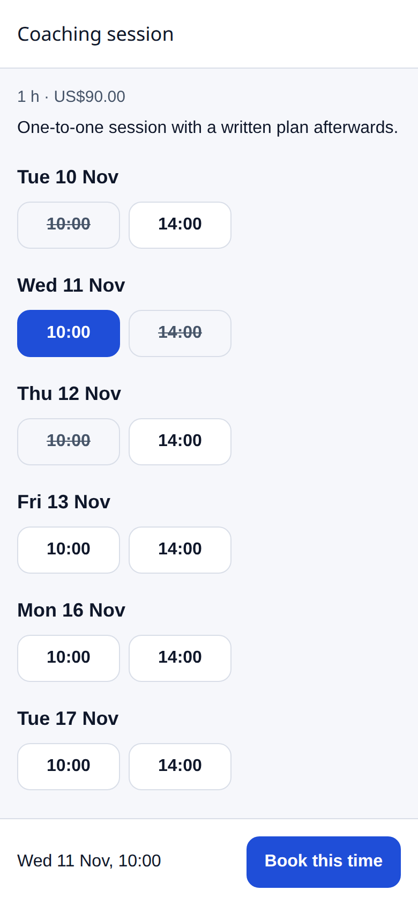
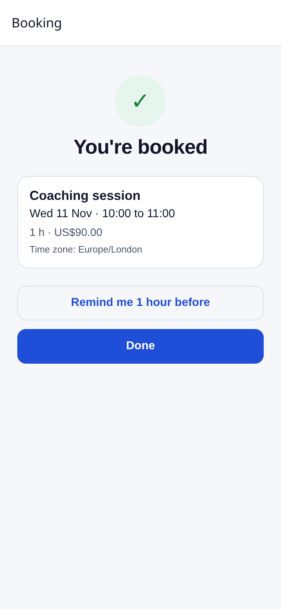
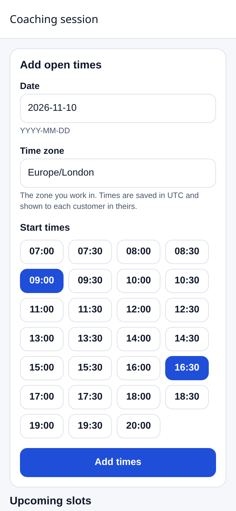
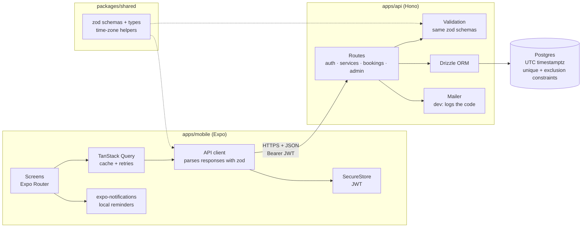

# mobile-booking

[](https://github.com/noamtzu/mobile-booking/actions/workflows/ci.yml)

A booking app for a small service business, such as a coach, a physio or a studio. Customers sign in with an emailed code, browse services, pick an open time and book it. They can also cancel, and they get a confirmation with an optional reminder. The owner gets an admin view to manage services and availability.

It is a complete, store-ready reference project: an Expo (React Native) app for iOS, Android and web, a typed Hono + Postgres API, and one set of zod schemas that both sides share.

| | |
|---|---|
| **Mobile** | Expo SDK 58, TypeScript (strict), Expo Router, TanStack Query, React Hook Form + zod, expo-notifications, expo-secure-store |
| **API** | Hono on Node, Postgres 17, Drizzle ORM, JWT auth with a one-time email code |
| **Shared** | `@booking/shared`: zod schemas, inferred types, time-zone helpers |
| **Quality** | Vitest (API, shared), Jest + React Native Testing Library (screens), ESLint, `tsc`, GitHub Actions |

## Screenshots

Expo web build at phone size (390x844), running against the local API with seeded demo data.

| Pick a time | Booking confirmed | Admin: availability |
|---|---|---|
|  |  |  |
| Open times grouped by local day; booked times are struck through. | The confirmation, with the time shown in the customer's zone and an optional reminder. | The owner adds open times as wall-clock times plus an IANA zone. |

## Architecture



### API

| Method | Path | Who | Purpose |
|---|---|---|---|
| `POST` | `/auth/request-code` | anyone | Email a 6-digit sign-in code |
| `POST` | `/auth/verify` | anyone | Exchange email + code for a JWT |
| `GET` | `/auth/me` | signed in | Current user |
| `GET` | `/services` | anyone | Active services |
| `GET` | `/services/:id/slots?from&to` | anyone | Future slots with availability |
| `GET` | `/bookings` | signed in | My bookings |
| `POST` | `/bookings` | signed in | Book a slot (`409 SLOT_TAKEN` if someone got there first) |
| `POST` | `/bookings/:id/cancel` | signed in | Cancel my booking, which frees the slot |
| `GET/POST/PATCH` | `/admin/services` | admin | Manage services |
| `POST` | `/admin/availability` | admin | Add slots from local times + an IANA time zone |
| `DELETE` | `/admin/slots/:id` | admin | Remove a slot that has no booking |

Errors always have the same shape, `{ "error": { "code": "SLOT_TAKEN", "message": "..." } }`, and the codes are a shared enum. The app can branch on a code instead of matching message text.

## Key decisions

**One schema, two sides.** Request bodies, responses and error codes are zod schemas in `packages/shared`. The API validates input with them. The app validates its forms with them and parses every response, so a contract change becomes a type error in both apps rather than a runtime surprise. Forms that need extra rules, such as price as text versus cents as an integer, build on the shared schema instead of copying it.

**Double booking is impossible, not just unlikely.** Booking runs in a transaction that locks the slot row (`SELECT ... FOR UPDATE`). The database also has the final say through a partial unique index:

```sql
CREATE UNIQUE INDEX bookings_one_confirmed_per_slot
  ON bookings (slot_id) WHERE status = 'confirmed';
```

If two requests still race past the application check, the second insert fails with a unique violation and the API returns `409 SLOT_TAKEN`. The app shows "Someone just booked that time" and refreshes the list. A test fires 20 concurrent bookings at one slot and asserts that exactly one succeeds. Another test inserts directly into the table to prove the constraint holds even when the application code is bypassed. Cancelling sets `status = 'cancelled'`, so the slot can be booked again and the history is kept.

Overlapping slots are blocked the same way, with an exclusion constraint on `tstzrange(starts_at, ends_at)`. The model here is a single provider. Supporting several staff would add a `provider_id` to that constraint.

**Store UTC, show local.** Every timestamp is a Postgres `timestamptz`, and the API only speaks ISO-8601 UTC. The app formats times with the device's zone and groups slots by local day, so a 23:30 UTC slot appears under the next day in Tokyo. Admins enter wall-clock times ("09:00 on 2026-03-29") plus an IANA zone, and the server converts them. Daylight-saving edges are handled explicitly: a time that does not exist (inside the spring-forward gap) is rejected with `422 NONEXISTENT_LOCAL_TIME`, and the repeated hour in autumn resolves to the first occurrence. These cases have tests for London, New York and others.

**Small, boring auth.** Sign-in is a 6-digit code sent by email. There are no passwords to store or reset. Codes are stored hashed, expire after 10 minutes, allow 5 attempts and work once. The JWT lives in the device keychain (SecureStore). In development the mailer prints the code to the API console. A production mailer such as Postmark, SES or Resend implements the same one-method interface.

**Every screen has its states.** Each data screen renders loading, empty and error states (with retry), and network failures get a clear message. Interactive elements have accessibility roles and labels, and controls have a 44 pt minimum touch target. Light and dark palettes are checked against WCAG AA contrast.

## Project layout

```
apps/
  api/          Hono API, Drizzle schema, SQL migrations, seed, Vitest tests
  mobile/       Expo app (src/app = routes), Jest + RNTL tests, app.json, eas.json
packages/
  shared/       zod schemas, types and time-zone helpers used by both
docker-compose.yml   Postgres 17 for local development
```

## Run locally

Requirements: Node 20.19+ (24 recommended, see `.nvmrc`), Docker, and the Expo Go app on a phone (or an iOS simulator / Android emulator).

```bash
npm install

# 1. Database
npm run db:up                                  # Postgres on localhost:5432

# 2. API
cp apps/api/.env.example apps/api/.env         # set JWT_SECRET; ADMIN_EMAILS gets the admin role
npm run db:migrate -w @booking/api
npm run db:seed -w @booking/api                # 3 services, 2 weeks of weekday slots
npm run dev:api                                # http://localhost:3000

# 3. App
cp apps/mobile/.env.example apps/mobile/.env
npm run dev:mobile                             # scan the QR code with Expo Go, or press w for web
```

On a physical phone, `localhost` is the phone itself. Set `EXPO_PUBLIC_API_URL` in `apps/mobile/.env` to your computer's LAN address, for example `http://192.168.1.20:3000`.

To sign in, enter any email. The code appears in the API terminal. Use the address from `ADMIN_EMAILS` to see the Admin tab.

## Testing

```bash
npm test             # everything
npm run lint
npm run typecheck
npm run build:web    # expo export --platform web
```

- **API** (`apps/api/test`, Vitest): auth (code expiry, attempt limits, single use, roles), booking (the 20-way race, the direct-insert constraint check, cancel and rebook, ownership), time zones (DST gap and overlap, storage round-trip in UTC) and admin rules. Tests run against an in-process Postgres ([PGlite](https://pglite.dev)) by default, so they need no setup. CI runs the same suite against a real Postgres 17 service through `TEST_DATABASE_URL=postgres://...`.
- **Shared** (`packages/shared/test`): time-zone conversion and schema rules.
- **Mobile** (`apps/mobile/__tests__`, Jest + React Native Testing Library): sign-in, service list, slot picker (including the "someone just booked it" path), my bookings with cancel, confirmation and reminder, and the admin screen. Tests query by accessible role and label, the same way a screen reader user finds things.

CI (`.github/workflows/ci.yml`) runs lint, typecheck, all tests and a web export on every push and pull request.

## Releasing to the stores with EAS

The app is configured for EAS Build and Submit. `app.json` holds the store metadata (bundle ID `com.example.booking`, icons, splash, notification icon, permissions), and `eas.json` has three profiles:

| Profile | Use | Output |
|---|---|---|
| `development` | Dev client for local debugging | Internal install |
| `preview` | QA and client review | iOS internal distribution, Android APK |
| `production` | Store release; build numbers auto-increment | App Store / Play bundles |

1. Replace the placeholders: `owner` and `extra.eas.projectId` in `app.json` (`eas init` fills these in), the bundle identifiers, and the API URLs in `eas.json`. Replace the icons in `apps/mobile/assets/` with final artwork.
2. `npm i -g eas-cli && eas login`
3. Preview build for testers: `eas build --profile preview --platform all`
4. Production build: `eas build --profile production --platform all`
5. Submit: `eas submit --platform ios` uploads to App Store Connect (TestFlight), and `eas submit --platform android` uploads to the Play Console internal testing track. Fill in `ascAppId` in `eas.json` first.
6. Promote from TestFlight or internal testing to production in the store consoles once the release is approved.

Over-the-air JavaScript updates (`eas update`) can be added for fixes that do not change native code.

## How I deliver this kind of work for clients

- **Scoped milestones.** The work is split into milestones that each end in something you can install, for example "sign-in and browsing", "booking and cancel", "admin and notifications". Each one has a fixed scope and acceptance criteria agreed up front.
- **Tests first on the parts that cost money when wrong.** Booking rules, payments, auth and time zones get tests before the UI is polished, like the race and DST tests in this repo.
- **A pull request per feature.** Each PR is small and reviewable, with a description, screenshots or a short screen recording, and green CI. You can follow progress in GitHub instead of waiting for a big reveal.
- **Real builds early.** From the first milestone there is a TestFlight / Play internal testing build on your phone, updated as features land.
- **Handover.** The project ends with a handover document: how to run it, how to release it, where the secrets live, the architecture and its trade-offs, and a list of known limits and next steps. The repo, the store listings and the cloud accounts are in your name.

## License

[MIT](LICENSE) © Noam Tzuberi
